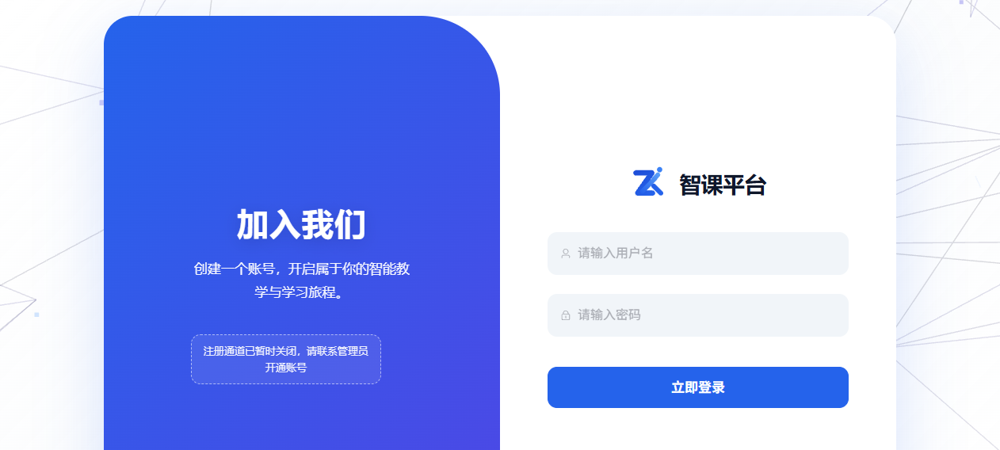
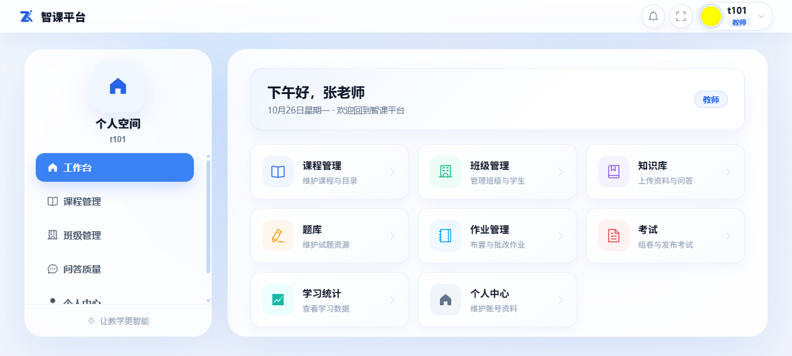
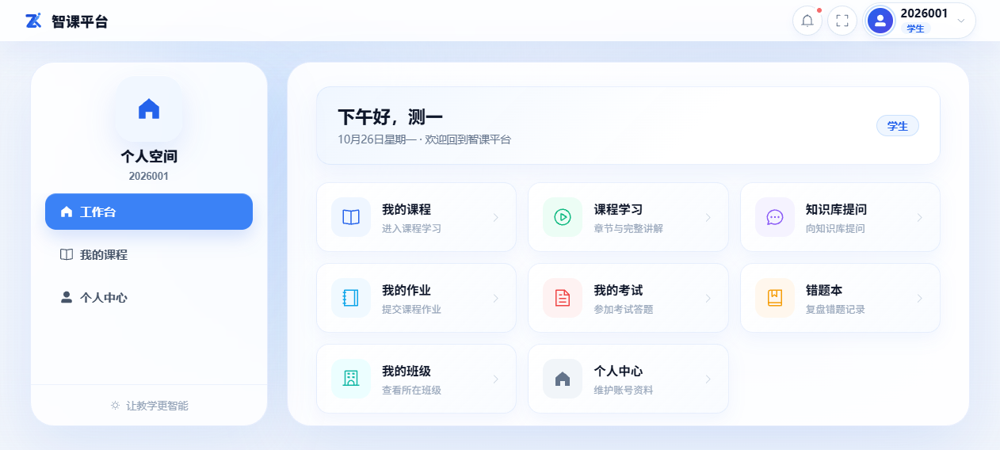
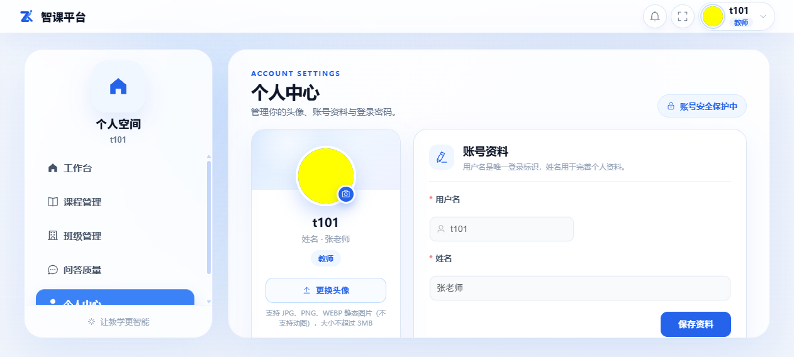

# 第一篇 入门

## 1.1 系统简介

智课系统 V2 是一套智能课程教学平台，覆盖「建课 → 教学 → 练习 → 测评 → 学情」的完整教学闭环。教师可以用 AI 能力把授课计划、课件（PPT/PDF）快速加工成可在线学习的课程：自动生成章节目录、逐页讲解稿与配套配音；学生端则提供连贯的课件连播学习、课程知识库智能问答、作业、考试与错题复习。

核心能力一览：

- **AI 课件工厂**：上传授课计划识别目录结构；上传课件自动解析分页；按页生成讲解稿（分批进行）并为每页配音
- **课程知识库问答（RAG）**：基于课程资料与课件的智能助教，回答附参考来源，不编造资料外的内容
- **题库 / 作业 / 考试**：支持单选、多选、判断、填空、简答五种题型；题目可手动录入、文档导入或 AI 生成；作业与考试支持客观题自动批改
- **学情分析**：班级学习统计、章节学习总结、AI 学情报告、学生个体详情
- **问答质量看板**：教师与管理员可监控 AI 问答的命中率、空答率、踩评率，持续改进资料质量

## 1.2 角色与权限一览

系统内置三类账号角色，登录后所见功能各不相同：

| 角色 | 主要能力 |
|---|---|
| **教师** | 创建课程与班级、管理章节课件与知识库、AI 问答、题库/作业/考试管理、批改、学情分析、问答质量看板 |
| **学生** | 加入班级学习课程（章节连播）、AI 助教问答、提交作业、参加考试、错题本、查看个人成绩与总结 |
| **管理员** | 用户账号管理、教学监管、操作审计、大模型能力配置、平台级问答质量看板 |

> 说明：管理员账号拥有全站通行权，但日常教学操作请使用教师/学生账号。

## 1.3 账号与登录

### 账号从哪里来

- 管理员在「用户管理」中统一创建账号，或批量导入学生账号；
- 若管理员开启了「开放注册」开关，登录页会出现注册入口，可自行注册。**默认情况下注册是关闭的**，请联系管理员开通账号。

### 初始密码

新账号的初始密码规则为：`Zk` + 用户名后 6 位。例如用户名 `2026001`，初始密码为 `Zk026001`（区分大小写）。首次登录后请立即在个人中心修改密码。

### 登录步骤

1. 打开系统地址，进入登录页；
2. 输入用户名（教师工号 / 学生学号）与密码；
3. 点击「立即登录」，成功后自动进入工作台。

> 连续输错密码会触发账号临时锁定，请核对大小写后再试；忘记密码请联系管理员重置。

## 1.4 认识工作台

登录后进入「工作台」，页面按角色自适应展示：

- **教师工作台**：所授课程、班级概况、待办事项与快捷入口
- **学生工作台**：已加入的课程、待完成作业、待参加考试等学习提醒

页面左侧为功能导航菜单，右上角可进入个人中心。教师、学生的「课程空间」（进入某门课程后的九个/八个功能页签）是日常使用的核心区域，后续篇章会逐一介绍。

## 1.5 个人中心

点击右上角头像 →「个人中心」，可以：

- 查看账号信息（用户名、角色）
- 维护姓名等个人资料（**姓名请填写真实姓名**，教师添加学生入班、作业考试名单均按姓名识别）
- 更换头像
- 修改登录密码

## 1.6 通用使用约定

- **AI 任务不丢进度**：讲稿生成、配音生成、AI 生题等耗时任务在后台分批执行。启动后可以离开页面去做别的事，再次进入相关页面时顶部会出现任务进度横幅，完成后自动刷新结果。
- **列表页操作**：表格行内的操作按钮（编辑、删除、统计等）位于每行末尾「操作」列；部分窄列表需要横向滚动查看。
- **时间与时限**：作业、考试均有开始/截止时间，逾期不可提交，请留意页面上的时间提示。
