# 第二篇 教师使用指南

## 2.1 快速上手：一门课从创建到学生可学

教师的核心工作流如下，按顺序执行即可完成一门课的搭建：

1. **创建课程**：课程管理 → 手动添加，填写课程名称等基本信息；
2. **建立班级并关联课程**：班级管理 → 新建班级，把学生加入班级；
3. **生成章节目录**：进入课程空间 →「章节与课件」，可手动添加章节，也可用「授课计划识别目录」让 AI 从授课计划文档中提取目录；
4. **上传课件**：在章节节点上上传 PPT/PDF 课件，系统自动解析分页并入库（可检索）；
5. **生成讲解稿**：对课件逐页生成 AI 讲解稿（分批进行，可离开页面）；
6. **生成配音**：为每页讲解稿生成语音配音（分批进行）；
7. **发布章节**：章节发布后，学生在课程空间即可连播学习；
8. **配套建设**：上传知识库资料（供 AI 助教检索）、建设题库、布置作业、创建考试、查看学情。

后续小节逐一详解。

## 2.2 课程管理

**入口**：左侧菜单「课程管理」。

- 列表展示本人负责的课程卡片，点击课程进入**课程空间**；
- 点击「手动添加」新建课程：填写课程名称、简介、学期等；
- 课程卡片上可编辑基本信息、进入管理。

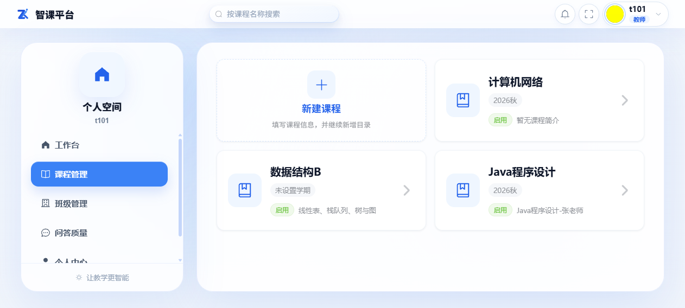

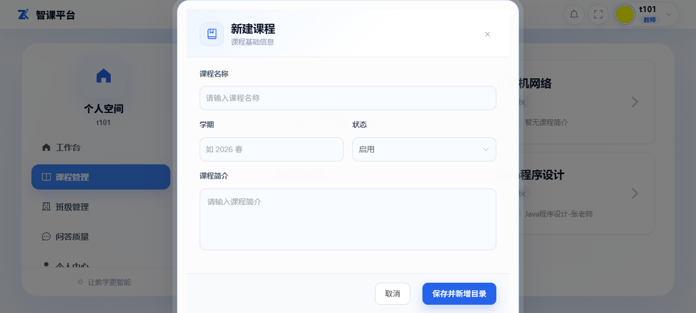

> 侧边栏的「知识库 / 题库 / 作业 / 考试 / 学习统计」全局入口与课程空间内对应页签功能相同，区别在于全局入口需先选择课程；日常教学建议直接进入课程空间操作。

## 2.3 章节与课件

**入口**：课程空间 →「章节与课件」（默认页）。

页面左侧是章节树，右侧是选中章节的课件与生成状态。章节节点悬停显示操作图标：上传课件、生成配音、讲解稿、完整讲解预览等。

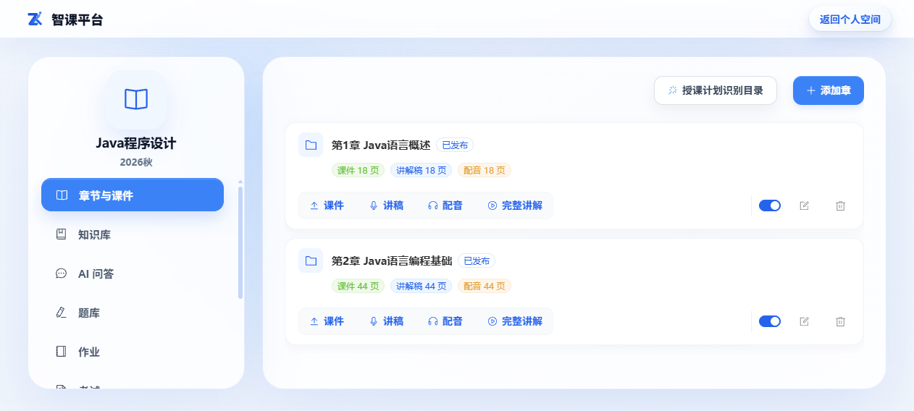

### 2.3.1 用授课计划识别目录

1. 点击页面顶部「授课计划识别目录」；
2. 上传授课计划文档（Word/PDF 等），系统自动识别章节结构；
3. 确认识别结果后生成目录；也可以随时用「手动添加」增补章节、拖动调整顺序。

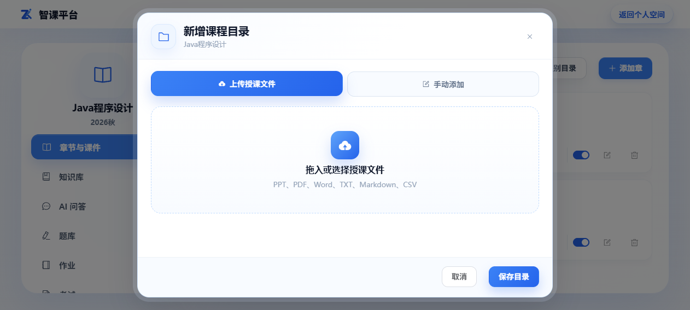

### 2.3.2 上传课件

1. 在章节节点上点击课件（上传）图标；
2. 选择 PPT/PDF 文件上传，面板显示解析进度；
3. 解析完成后，课件按页展示缩略图与文字内容，自动进入课程知识库可检索范围。

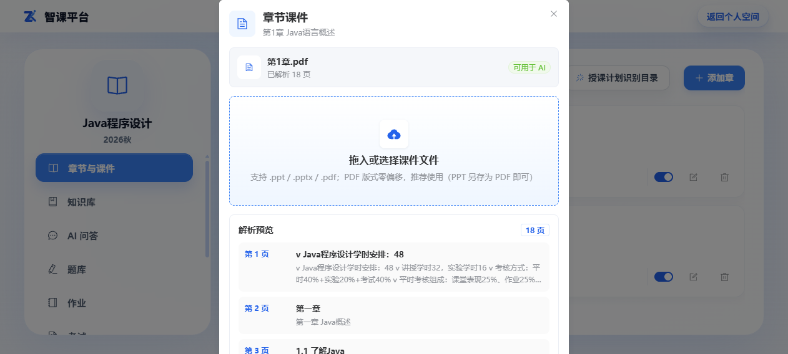

> 同一章节重复上传会替换为新版本；解析失败的页面可重试。

### 2.3.3 生成讲解稿与配音

1. 课件解析完成后，点击章节节点上的「讲稿」图标发起讲解稿生成；
2. 讲解稿按页分批生成（每小批数页），配音按页逐页合成，均在后台执行；
3. 顶部出现任务进度横幅，可离开页面处理其他工作，回来自动刷新；
4. 生成完成后，点击「讲稿」打开「讲解稿与配音」面板：逐页查看/校对讲稿文本、试听配音，可对单页「重新生成本页」讲稿或「重新配音」。

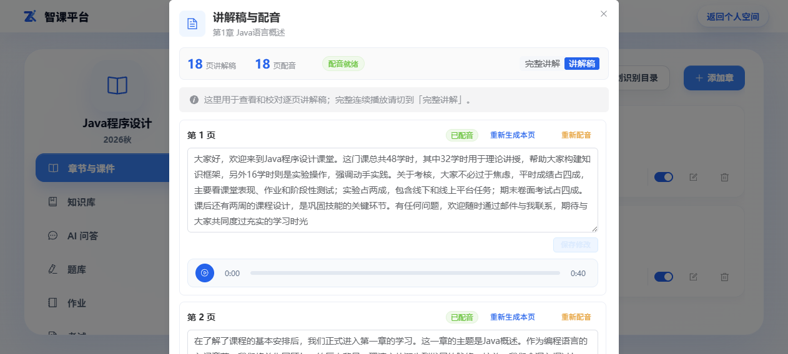

5. 点击「完整讲解」进入整章连播预览（与学生端学习页一致），整体检验一遍效果。

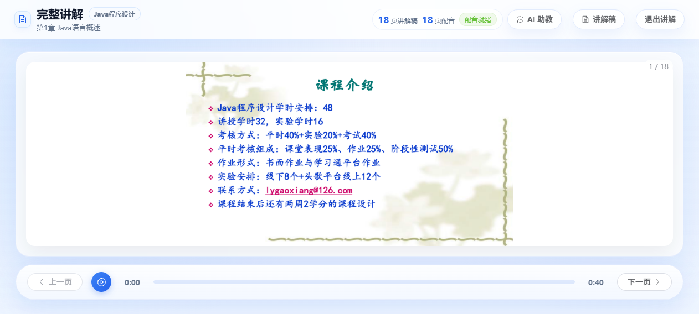

> 讲解稿与配音的生成依赖管理员配置的 AI 能力；若生成失败，重试对应章节即可，已完成的页不会重复生成。

### 2.3.4 发布章节

讲稿与配音就绪后，将章节设为「发布」状态。只有已发布章节学生才可见、可学习；未发布章节对学生隐藏。

## 2.4 知识库

**是什么**：课程专属的资料库，上传的教辅资料经切分、向量化后成为 AI 助教回答的检索来源。

**入口**：课程空间 →「知识库」。

**操作**：

1. 点击右上角「上传教辅资料」，选择文件（支持 PDF/Word/PPT/TXT/Markdown 等）；
2. 上传后系统自动解析入库，列表中显示解析状态；
3. 资料可关联到具体章节（章节语义问题优先在该章节资料中检索）；
4. 资料失效可删除；**「重建向量」仅在你需要更换向量模型等运维场景使用**，日常使用无需点击。

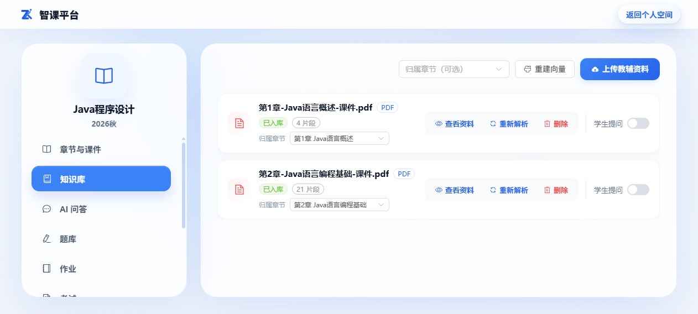

## 2.5 AI 问答

**入口**：课程空间 →「AI 问答」。

教师可在课程语料范围内试提问，验证知识库资料覆盖效果：回答附参考来源（讲稿/资料页级引用），资料不足时系统如实提示。教师提问语料与学生一致，常用于备课自检与答疑预演。页面右上角支持「新建会话」与「历史记录」回看。

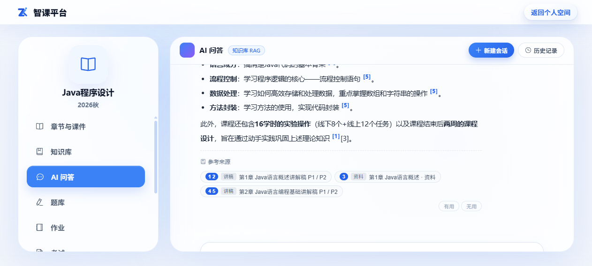

## 2.6 题库

**入口**：课程空间 →「题库」。支持单选、多选、判断、填空、简答五种题型。

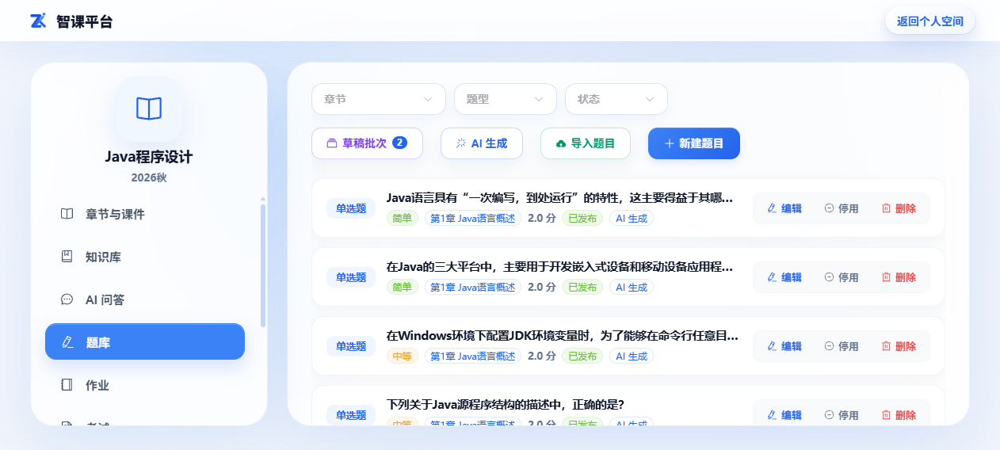

### 2.6.1 手动录入

1. 点击「新建题目」；
2. 选择题型，填写题干、选项（客观题）、答案、解析、分值、难度与所属章节；
3. 保存后题目默认进入题库；状态为「已发布」的题目才能被作业/考试选用。

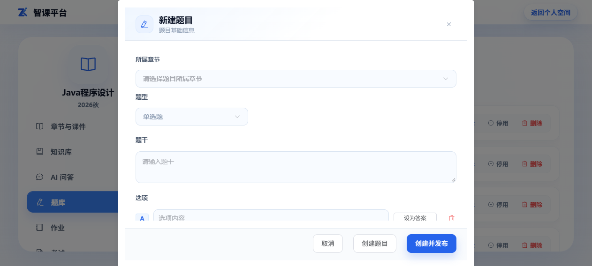

> 填空题按空设置答案与分值；多选题可设置漏选得分规则（以页面选项为准）。

### 2.6.2 文档导入

1. 点击「导入题目」，上传题目文档（PDF/Word/TXT/Markdown）；
2. 系统自动解析题目结构并打开预览抽屉：逐题核对、可直接修改；
3. 勾选题目后点击「入库勾选的 N 题」；如需立即用于作业/考试，勾选「入库后立即发布」；
4. 与题库中已有题目**题干完全重复**的题目会被跳过（保留在批次中，可修改后重试）。

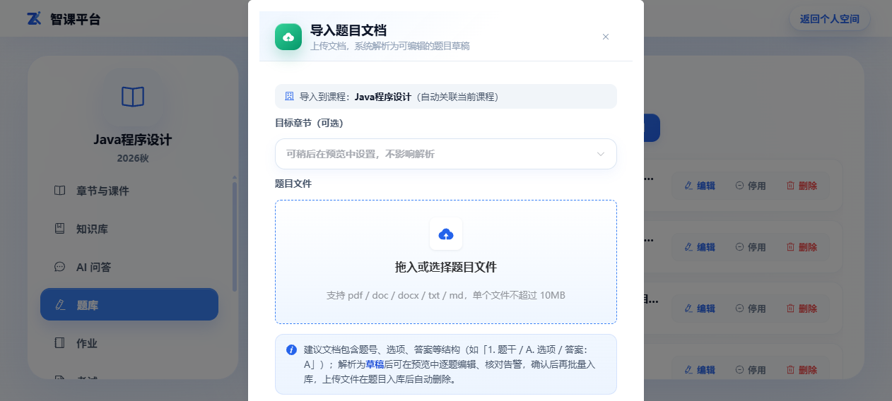

### 2.6.3 AI 生题

1. 点击「AI 生成」，选择题型、数量、难度与出题范围（章节/知识点）；
2. 任务在后台分批生成，顶部横幅显示进度，可离开页面；
3. 生成完成后自动打开草稿预览：逐题审阅、修改，确认后入库；
4. 未处理完的批次可从题库页「草稿批次」入口随时打开继续。

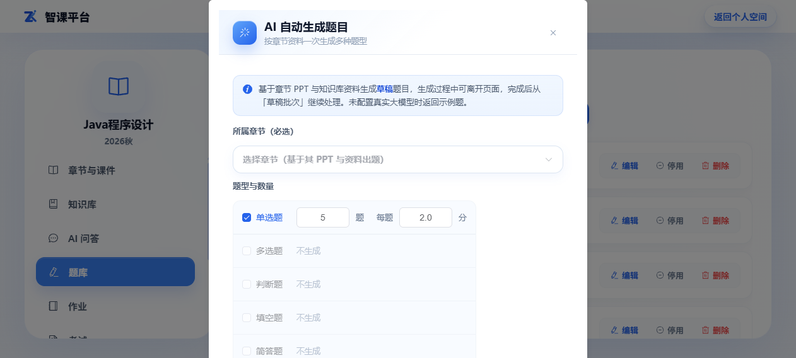

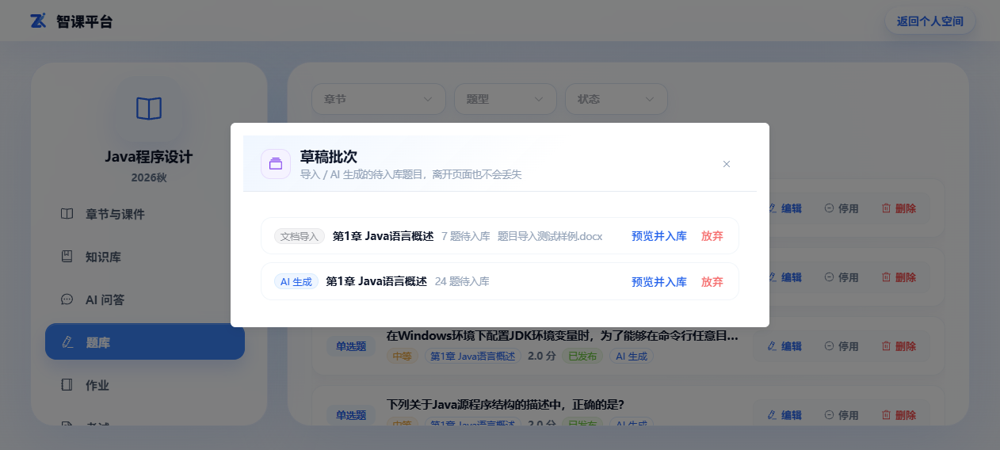

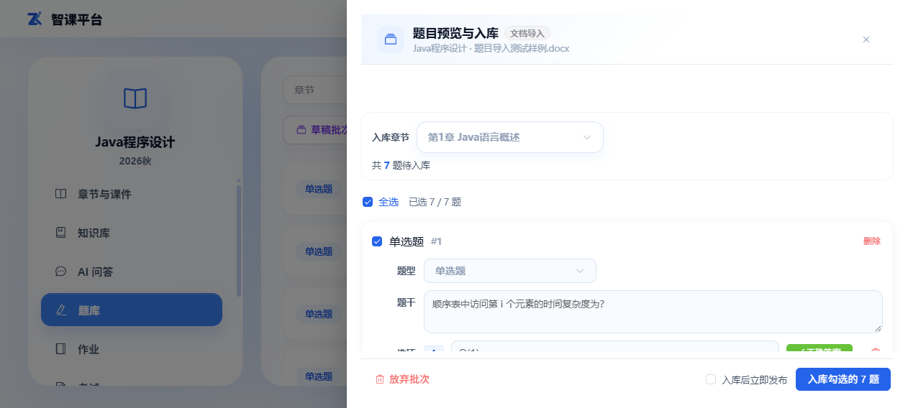

> 同一课程同时只允许一个进行中的生题任务；草稿批次未入库前可随时返回继续处理，或整批放弃。

## 2.7 作业

**入口**：课程空间 →「作业」。

### 2.7.1 创建作业

1. 点击「发布作业」；
2. 填写标题、说明、截止时间，选择目标班级；
3. 两种模式：**题库选题**（从本课程题库选已发布题目，客观题自动批改）或**附件作业**（学生上传文件，可附多份参考附件）；
4. 保存草稿或立即发布；发布后学生在课程空间「我的作业」中可见。

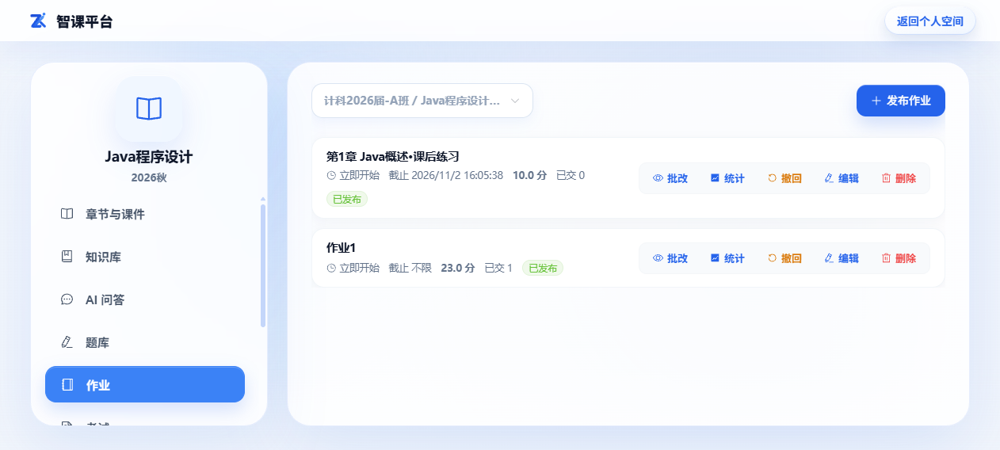

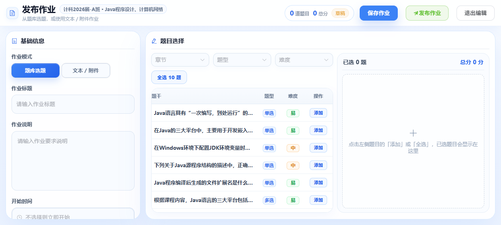

### 2.7.2 批改作业

1. 在作业列表点击对应作业的「批改」进入提交批改面板（显示已提交/待批改/平均分与提交名单）；
2. 客观题由系统自动批改；主观题逐人评分并填写评语；
3. 批改完成点击「提交批改」**发布**后，学生才能看到分数与评语。

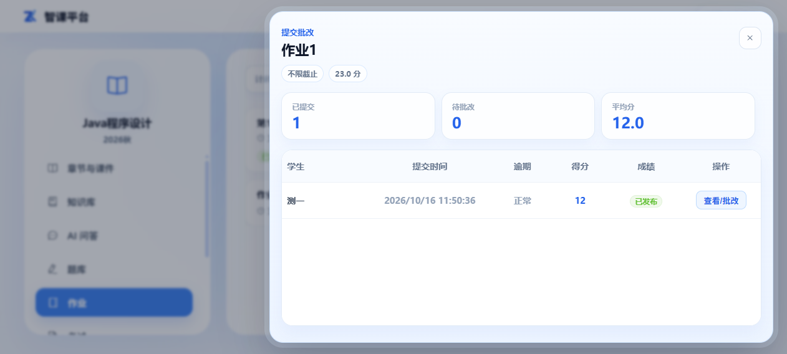

### 2.7.3 作业统计

作业列表 →「统计」：查看提交率、得分分布、每题正确率，定位普遍薄弱题目。

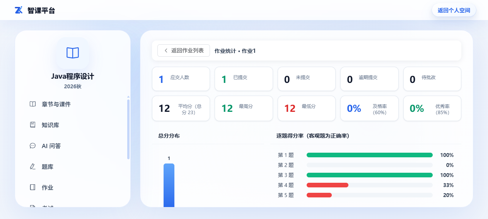

## 2.8 考试

**入口**：课程空间 →「考试」。

### 2.8.1 创建考试与组卷

1. 点击「新建考试」，填写名称、考试起止时间、时长、目标班级；
2. 按需开启：题目乱序、选项乱序、防切屏监测、考后展示解析、允许重考；
3. 保存草稿后进入「组卷」：支持**手动选题**（勾选题目与分值）或**随机组卷**（按题型/难度/章节规则抽题，可每个学生一套卷）；
4. 组卷完成后「发布」，学生在考试时间内即可进入作答。

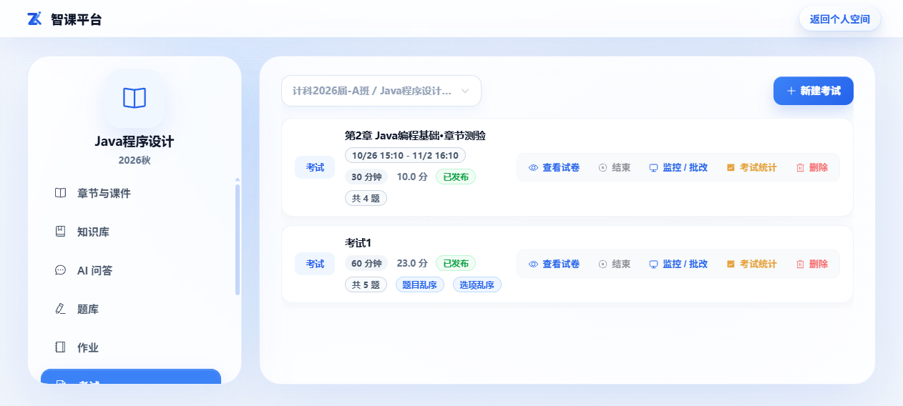

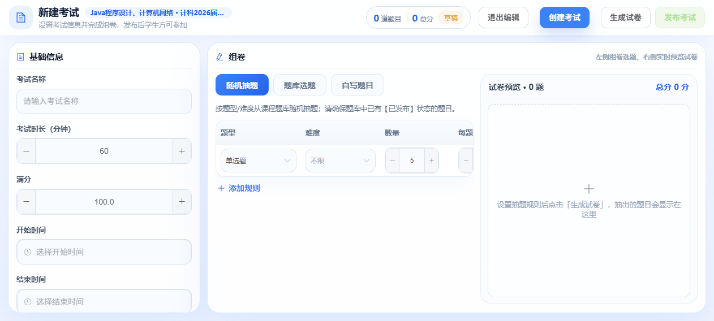

### 2.8.2 监考与批改

- 考试中可通过「监控 / 批改」查看进行中状态与异常日志；
- 客观题交卷即自动判分；含主观题时需教师评分；
- 全部批改完成后，点击「统一出分（发布全部成绩）」，学生才能查看成绩与解析。

### 2.8.3 考试统计

考试 →「统计」：参考率、得分分布、每题正确率与清单，用于讲评与补测决策。

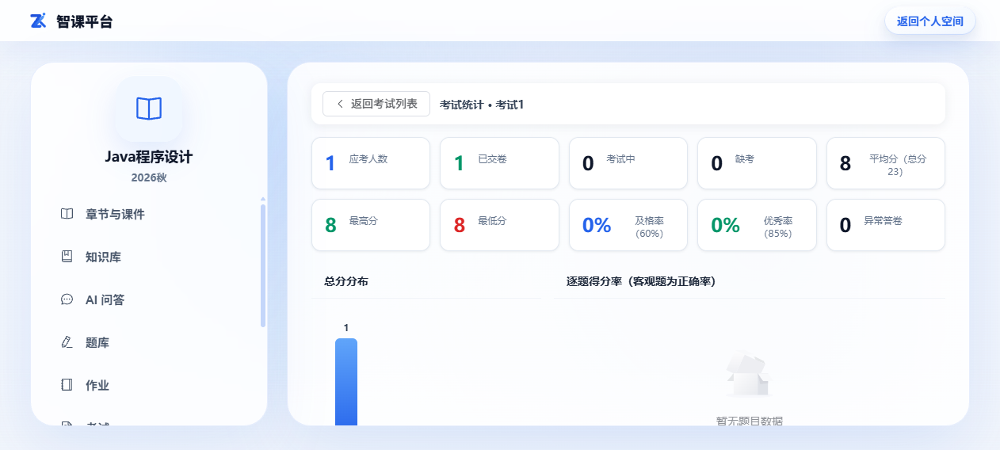

> 注意：成绩发布前学生端仅显示「待出分」；发布后不可撤回，请确认批改无误再发布。

## 2.9 教学资源

**入口**：课程空间 →「教学资源」。

管理课程的教学资源（视频、文件、链接等）：点击「添加资源」上传/登记，可发布、下架、复制链接；学生端在「课程资源」中查看。点击「预览」可在资源查看器中检查呈现效果。

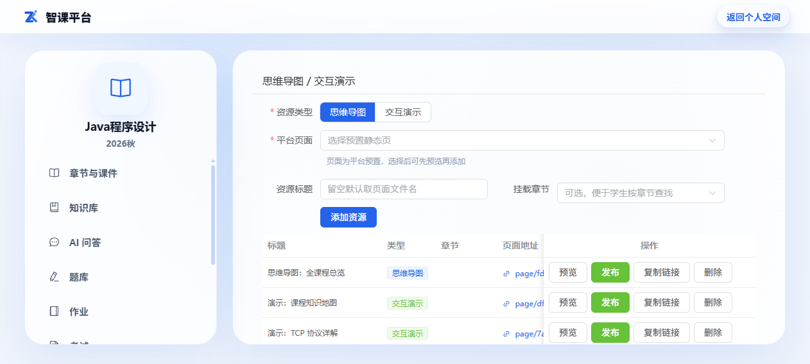

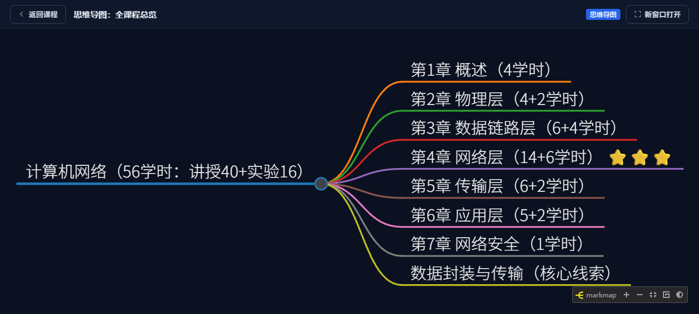

## 2.10 虚拟实验

**入口**：课程空间 →「虚拟实验」。

创建/安排实验任务、查看学生提交与成绩。学生端在课程空间「虚拟实验」中进入。

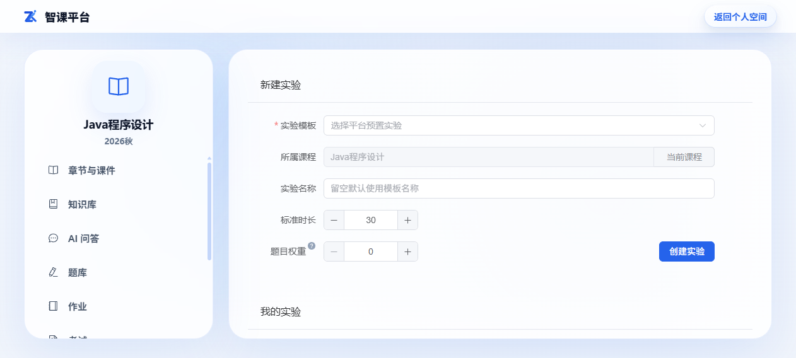

## 2.11 学习统计

**入口**：课程空间 →「学习统计」。

- **班级学情列表**：按班级查看每名学生的最近学习时间、章节练习正确率、作业/考试提交与均分、实验完成情况，支持搜索与筛选；
- **章节 AI 总结**：学生详情页按章节查看该生的章节学习总结（含薄弱点证据，见下方「学生详情」）；
- **AI 学情报告**：对班级整体学情生成分析报告，支持历史报告回看；
- **学生详情**：点击学生进入个体页，查看其学习轨迹、作业考试明细与章节总结。

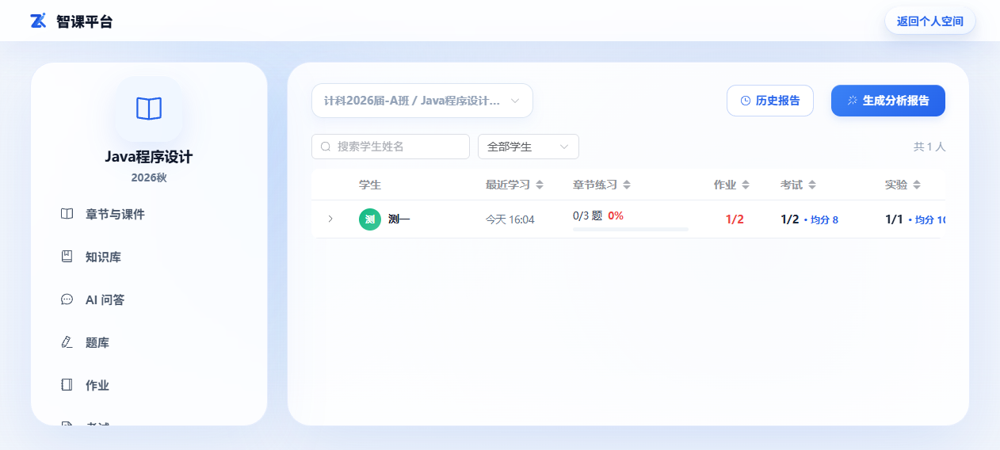

**AI 学情报告**：点击「生成分析报告」发起（异步任务，完成后自动呈现）；点击「历史报告」可回看历次报告全文。

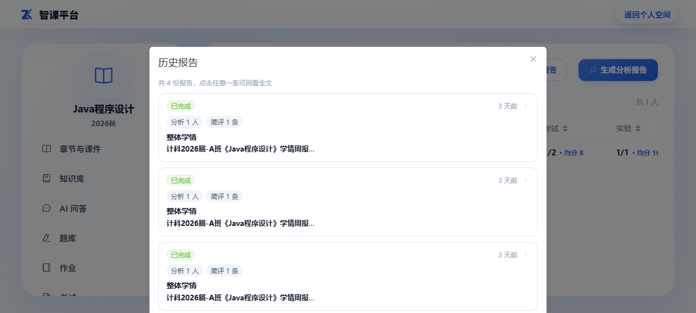

**学生详情与章节总结**：点击学生进入个体页——顶部为预警标签与指标卡（学习进度、练习正确率、作业/考试提交与均分、实验情况），下方为明细数据；「AI 章节总结」区可按章节查看该生的学习总结（本章概览、知识点掌握、薄弱点、学习亮点等）。

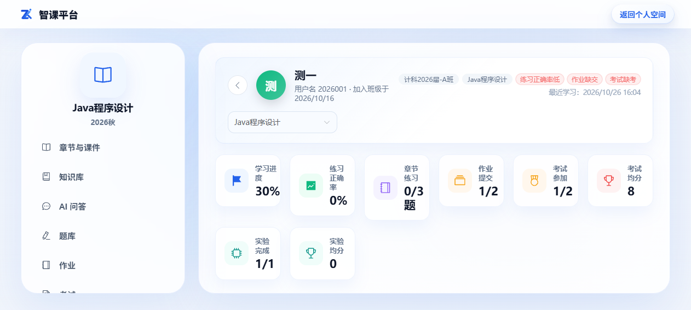

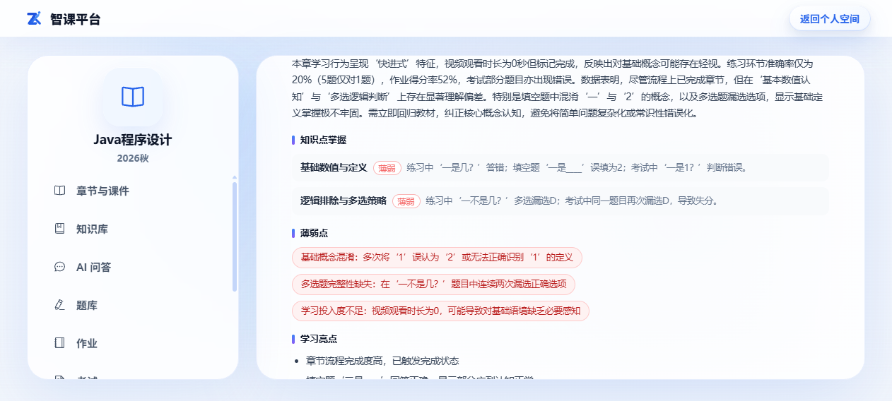

> AI 学情报告为异步任务：提交后顶部显示进度，完成后自动呈现；同一班级 10 分钟内不可重复生成。

## 2.12 班级管理

**入口**：左侧菜单「班级管理」。

1. 点击「新建班级」创建班级，并关联课程；
2. 班级行点击「学生」进入学生管理：搜索添加学生、批量导入、移除学生；
3. 也可开启「邀请码」，把邀请码发给学生自助加入（学生端「我的课程」中输入邀请码）；
4. 点击学生姓名进入其个人学情详情页。

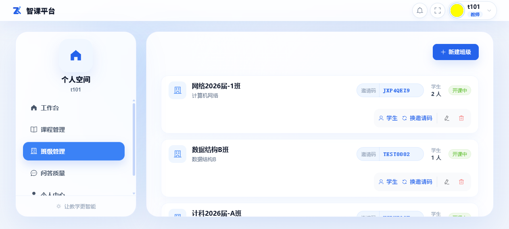

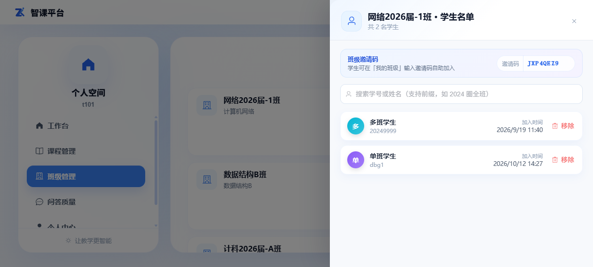

> 学生账号需先在平台注册（或由管理员创建）；学生资料中**姓名**需完整，否则无法被加入班级。

## 2.13 问答质量看板

**入口**：左侧菜单「问答质量」。

监控本课程 AI 问答的运行质量：

- **指标卡**：提问量、命中率、空答率、踩评率等（悬停问号图标查看口径说明）；
- **问题下钻**：查看空答（未检索到资料）与被学生踩评的具体问题，据此补充知识库资料或优化章节归属；
- **课程级告警**：指标越过阈值时给出提示与处理建议。

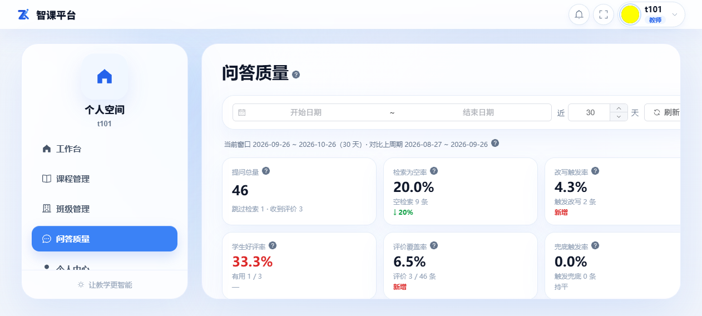

> 纯图片提问不计入空答率分母；持续空答率高通常意味着课程资料覆盖不足，优先补充对应章节资料。
