# 第三篇 学生使用指南

## 3.1 我的班级与课程入口

登录后进入工作台，左侧菜单点击「我的课程」（即我的班级），可以看到自己加入的所有班级及其关联课程。

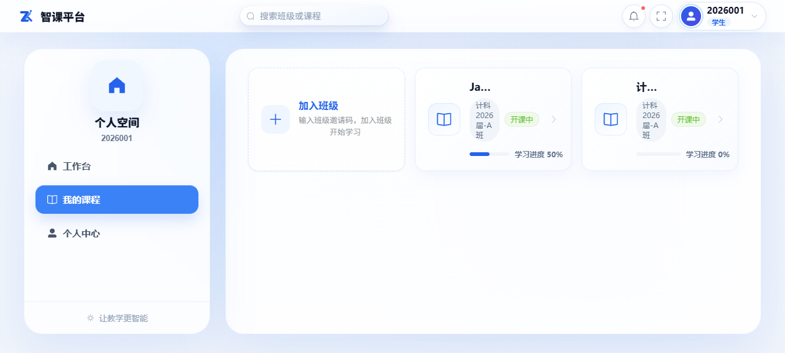

点击课程卡片进入**课程空间**。课程空间顶部有一排功能页签：章节目录、AI 助教、课程资料、课程资源、虚拟实验、我的作业、我的考试、错题本。本篇章节逐一介绍。

> 侧边栏的「课程学习」「知识库提问」「我的作业」等全局入口与课程空间内功能相同，适合快速查看所有课程的待办；日常学习建议直接从课程进入。

## 3.2 课程学习（章节连播）

**是什么**：按章节观看课件，每页课件配有 AI 生成的讲解稿与配音，像看视频课一样连贯学习。

**入口**：课程空间 →「章节目录」（默认页）。

**操作步骤**：

1. 在章节列表中点击要学习章节的「完整讲解」；
2. 进入连播学习页：中部是课件画面（右上角显示页码，如 1/18），底部是播放控制条（播放/暂停、进度、时长）；
3. 一页学完后自动连播下一页（约 10 秒间隔），也可以点击「上一页/下一页」手动翻页；
4. 顶部可切换「讲解稿」查看本页讲稿文本，点「AI 助教」可就不懂的地方即时提问；
5. 学习进度自动记录，下次进入可从上次位置继续；章节学完后目录显示「已完成」。

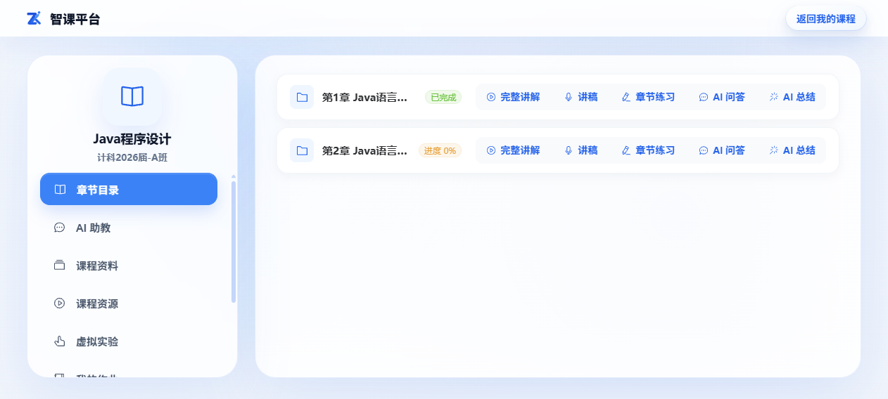

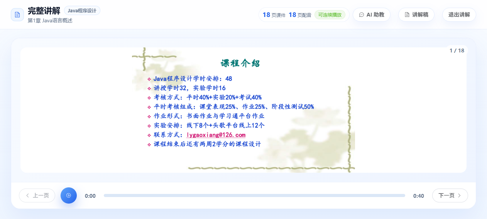

**注意**：

- 只有教师已发布的章节才会出现在目录中；
- 翻页后学习进度即自动保存，无需手动操作；
- 章节条目上还有「章节练习」入口：针对本章题目做即时练习，作答自动判分，答错的客观题会自动收录进错题本（见 3.8）。

## 3.3 章节 AI 总结

**是什么**：学完一章后，系统可自动汇总本章你的学习情况：课件要点、作业与考试中的错题证据、掌握建议。

**入口**：课程学习页的「章节总结」按钮。

**操作步骤**：

1. 在学习页点击「章节总结」；
2. 若总结已生成，抽屉中直接展示完整内容；若显示「生成中/待生成」徽标，说明系统正在后台汇总，稍后重新打开即可；
3. 总结内容通常包含：章节知识点梳理、你的作答薄弱点、复习建议等区块。

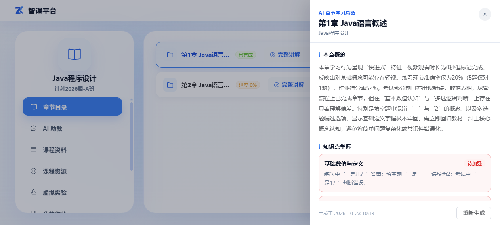

> 总结由 AI 基于你的真实学习数据生成，仅自己可见；数据越多（完成作业/考试后），总结越有针对性。

## 3.4 AI 助教（知识库问答）

**是什么**：围绕本课程资料与课件的智能问答。回答会附「参考来源」（资料名/课件章节），资料不足时会如实告知，不会编造。

**入口**：课程空间 →「AI 助教」。

**操作步骤**：

1. 在底部输入框输入问题（建议描述具体，如「Java 的三大平台分别是什么？」）；
2. 点击「发送」，回答以流式逐字返回；
3. 回答末尾可展开「参考来源」，点击来源可定位到对应资料；
4. 同一课程的问答按会话保存，可在历史会话中回溯。

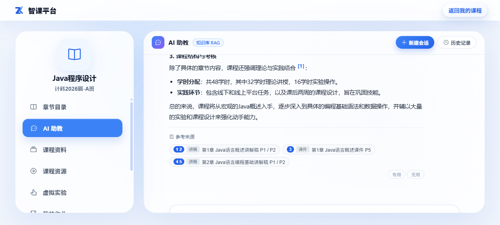

**注意**：

- 当管理员配置的对话模型支持图片理解时，输入区会显示图片上传入口，可拍照/截图提问（如拍一道题）；看不到该入口说明当前模型不支持图片，直接文字提问即可；
- 问答内容仅基于本课程资料，问其他课程的问题请切换到对应课程空间。

## 3.5 课程资料与课程资源

- **课程资料**（课程空间 →「课程资料」）：教师上传到知识库、供学习查阅的教辅文档（PDF/Word 等），可在线预览；
- **课程资源**（课程空间 →「课程资源」）：教师发布的教学资源（视频、链接、文件等），点击「查看/播放」打开资源查看器。

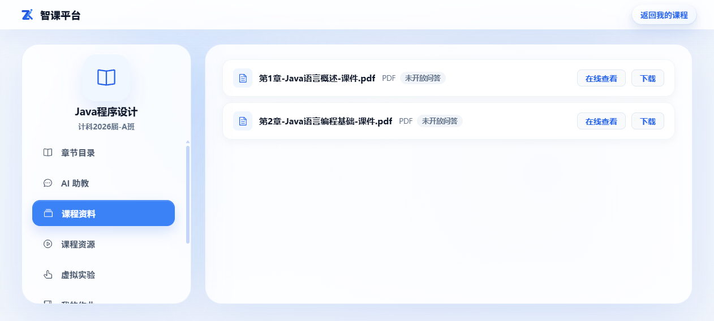

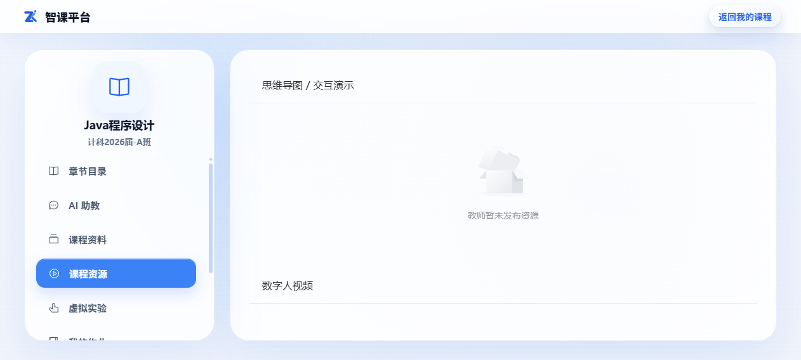

## 3.6 我的作业

**入口**：课程空间 →「我的作业」。

**列表状态**：「未提交」（待完成）、「已提交」（待教师批改）、「已发布 X 分」（教师批改发布后可查看成绩明细）。

**提交作业**：

1. 在列表中找到未提交的作业，点击「查看作业」进入作答页；
2. 题目型作业直接在线作答（客观题点选，主观题输入文字）；附件型作业按要求上传文件（支持多附件）；
3. 截止前可多次修改，确认后提交。

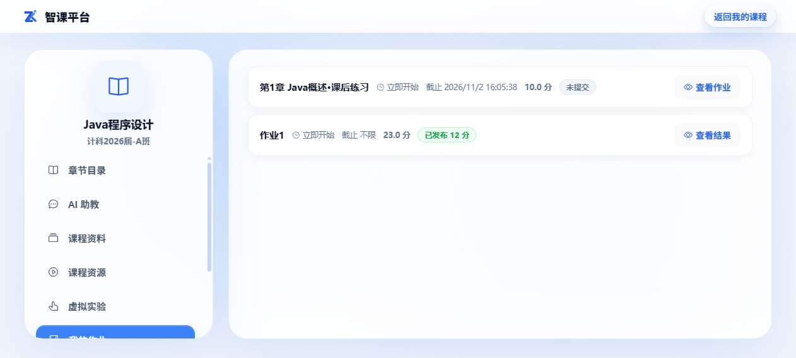

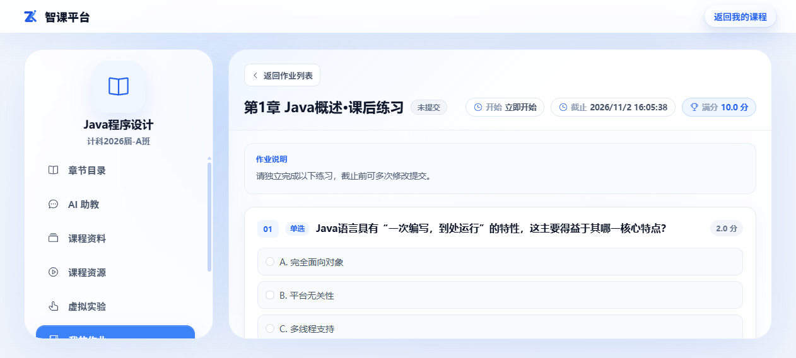

**查看批改结果**：教师批改发布后，作业状态变为「已发布 X 分」，点击「查看结果」可见本次得分、我的提交与批改情况。

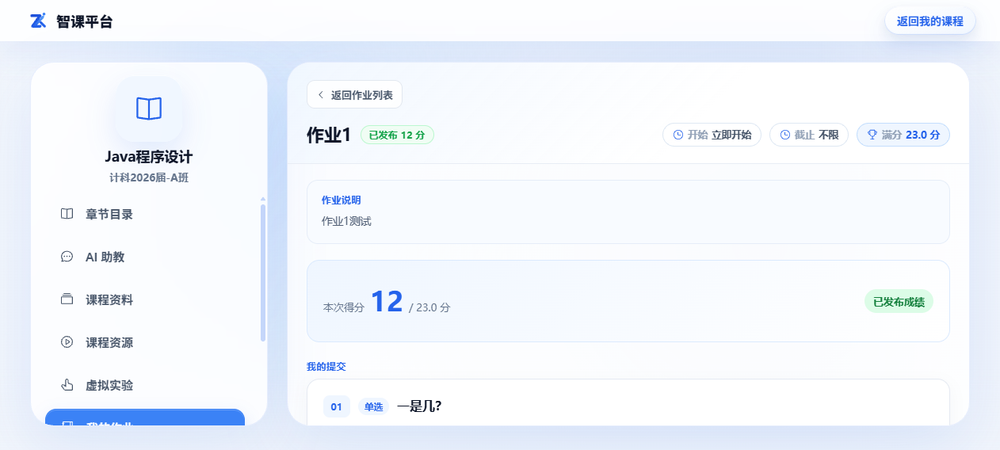

> 注意：在教师批改发布之前，作业分数不可见；客观题提交后由系统自动批改，但仍需教师发布后才展示。

## 3.7 我的考试

**入口**：课程空间 →「我的考试」。

**参加考试**：

1. 在列表中找到进行中的考试，点击「进入考试」；
2. 系统进入全屏答题页（隐藏导航，避免误跳出），顶部显示剩余时间；
3. 逐题作答，答案自动保存；左侧题号导航可快速跳转；
4. 答完点击「提交答卷」，在确认框中确认后提交（提交后不可再进入，除非教师允许重考）。

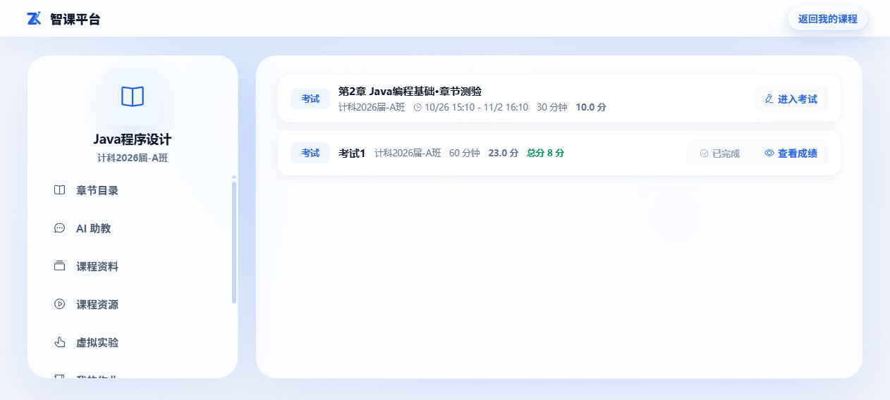

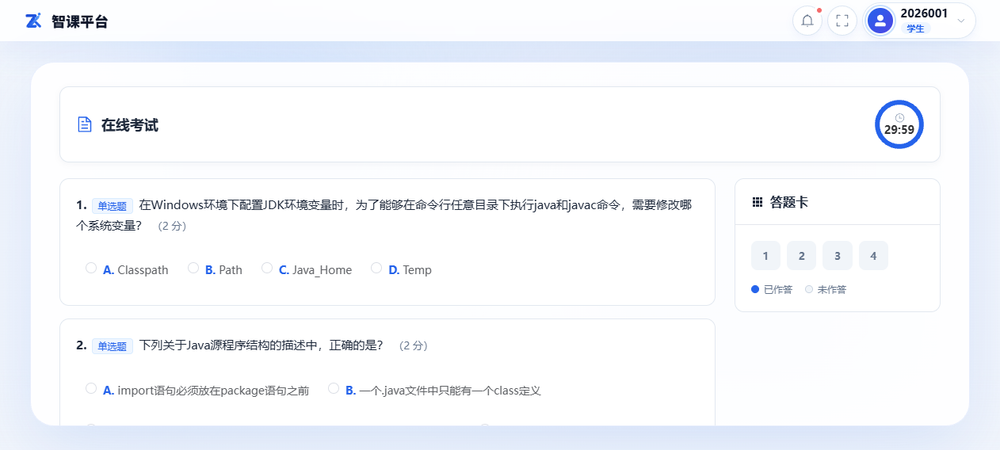

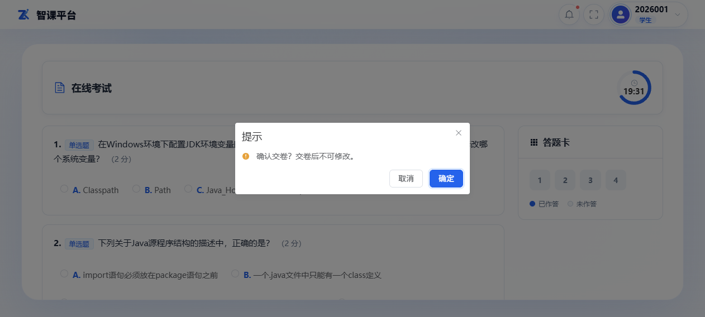

**查看成绩与解析**：教师发布成绩后，考试行显示「总分 X 分」，点击「查看成绩」进入答题情况页，可查看客观题得分、总分、每题对错与答案解析。若考试开启了选项乱序，回看按原题顺序展示，与考试时所見顺序可能不同。

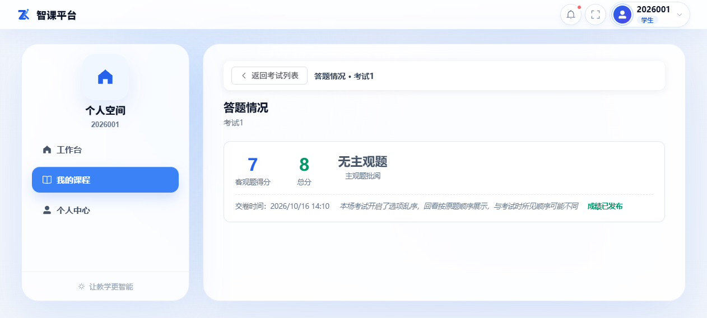

**注意**：

- 考试一旦到截止时间会自动交卷；
- **成绩由教师统一发布**，交卷后立即看不到分数属正常现象；
- 若教师开启了防切屏监测，考试期间切换页面会被记录；
- 试卷题目/选项可能乱序（因考试设置而异），不必与他人比对题号。

## 3.8 错题本

**是什么**：练习/作业/考试中答错的客观题自动收录进错题本，也可以手动添加典型错题，按课程集中复习。

**入口**：课程空间 →「错题本」。

**操作**：

- 点击错题卡片展开详情：题干、我的答案、正确答案、解析；
- 掌握后可标记，便于筛选未掌握题目；
- 点击「添加错题」可手动录入题干与自己的错误答案。

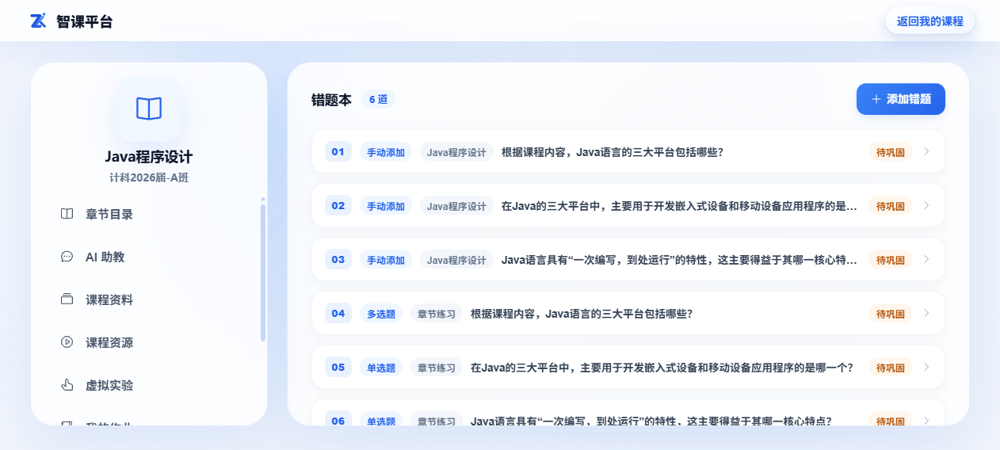

## 3.9 虚拟实验

**入口**：课程空间 →「虚拟实验」。

列表展示教师安排的实验任务，点击进入实验环境完成操作并提交实验报告；成绩可在实验列表中查看。

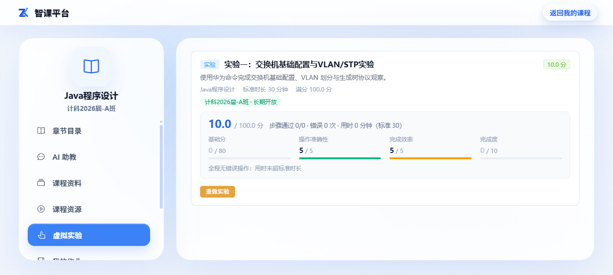
