# 第四篇 管理员使用指南

> 管理员负责平台账号、运行监管与 AI 能力配置。管理员账号拥有全站通行权，请妥善保管密码，日常教学请勿使用管理员账号操作。

## 4.1 管理概览

**入口**：左侧菜单「管理概览」。

集中查看平台规模与运行趋势：平台用户（教师/学生数及环比）、课程总数、教学班级、学习关系与活跃度，以及业务数据库实时统计。

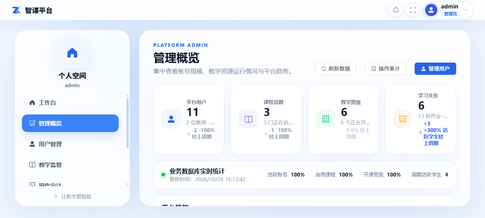

## 4.2 用户管理

**入口**：左侧菜单「用户管理」。

### 4.2.1 新建账号

1. 点击工具栏「新建账号」；
2. 填写用户名、姓名、角色——用户名规则按角色分档：**学生 6～8 位学号、教师与管理员 3～10 位工号**，只能由字母和数字组成（不符合会立即提示）；
3. 保存后系统自动生成初始密码，规则为 `Zk` + 用户名后 6 位（不足 6 位左补 0），新建与重置密码时默认填入，可修改；请提醒用户首次登录后自行修改。

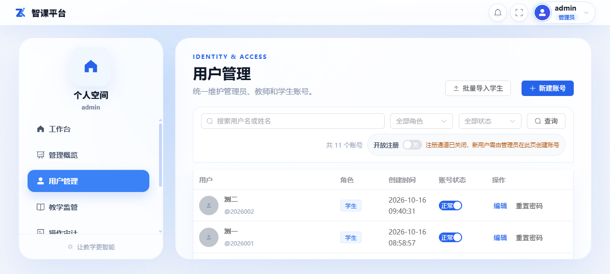

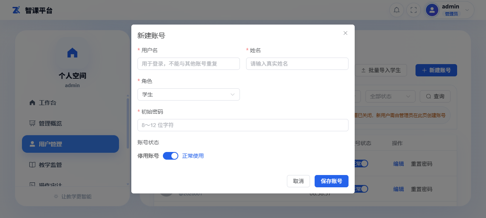

### 4.2.2 批量导入（班级 / 教师 / 学生三类）

管理端「用户管理」与「班级管理」统一接入导入向导（三步：上传文件 → 核对预览 → 导入结果）：

1. **下载模板**：按需选择班级、教师或学生模板。学生模板为「学号 / 姓名 / 班级编码 / 班级名称 / 入学年」五列，其中只有学号与姓名必填；支持 .xlsx，单次不超过 500 行 / 5MB；
2. **上传文件**：按模板填写后上传，账号不合规的行会在预览阶段标红（学号 6～8 位且仅字母数字）；
3. **核对预览**：查看成功 / 失败 / 跳过三态统计、错误行逐条原因，以及「待自动创建的班级」清单（可修改、可勾选）；
4. **导入结果**：汇总结果、新建班级清单、失败行与**初始密码表**均可下载发放。

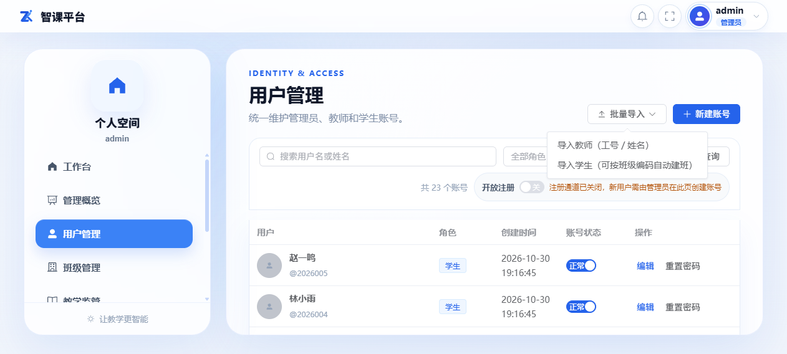

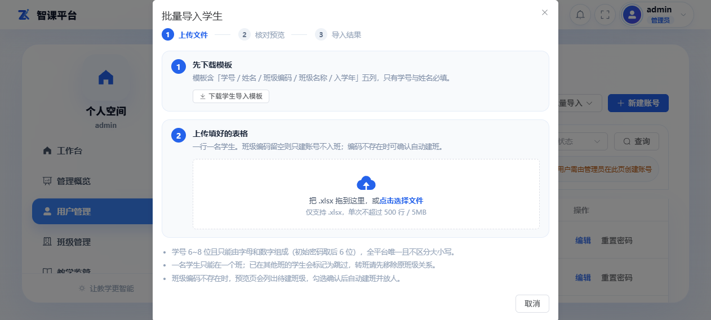

> 学生导入按班级编码自动建班（编码去空格、统一大写、忽略大小写匹配），空壳班不会创建；已存在的账号自动复用并补入班——重复上传是幂等的（已存在计为「跳过」而非失败）。

### 4.2.3 编辑、重置密码与停用

- 行内「编辑」可修改姓名、角色等（**账号本身未改动时不校验长度**，历史账号仍可正常改资料）；「删除」移除账号（有教学数据的账号受保护）；
- 用户忘记密码时使用「重置密码」，重置后按 `Zk` + 账号后 6 位告知；
- 停用学生账号会联动把学籍置为「已退学」；
- 表格支持按角色/关键字查询与导出。

### 4.2.4 开放注册开关

工具栏「开放注册」开关（见 4.2.1 用户管理截图的工具栏区域）控制登录页是否显示注册入口。**默认关闭**（新部署系统即为关闭状态）；关闭时登录页注册入口隐藏，注册接口同时拒绝请求。切换动作会落操作审计。

## 4.3 班级管理

**入口**：左侧菜单「班级管理」。班级与学籍的写操作**统一归口管理员**（教师端为只读视图）。

### 4.3.1 新建班级

1. 点击「新建班级」，填写班级名称、**班级编码**（导入与匹配的唯一键，统一大写）、届别（入学年份）、学制；
2. 班级状态分四态：筹备中 / 在读 / 已毕业 / 已归档；
3. 保存后可在班级卡片上「学生」进入名单；点卡片上的「编辑班级」图标可修改班级信息、关联课程与开课/结课时间。

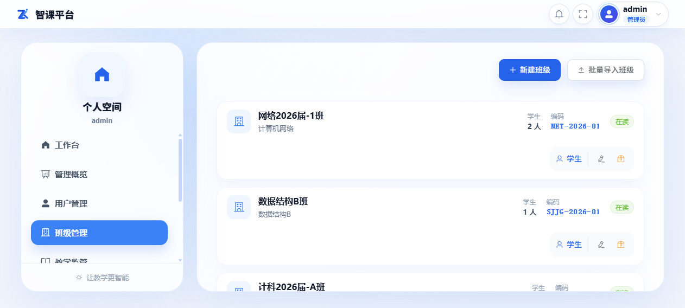

> 班级不可直接删除，请改用「已归档」状态收尾（直接删除会破坏历史成绩与学习记录）。

### 4.3.2 学生名单与学籍管理

从班级卡片点击「学生」进入**独立名单页**：按姓名 / 学号搜索，按学籍与学习状态筛选，按最近登录等字段排序；行内提供「详情」「学籍」「移除」。

- **添加学生**：搜索学生账号加入班级（**同一学生同时只能占用一个班**，加入新班需先转出或移出原班）；
- **学籍变更**：在行内「学籍」中设置在校 / 休学 / 已毕业 / 已退学，并填写变更备注；
- **转班 / 移出**：转班记为「已转出」（保留历史成绩可见），移出为「已移出」；转出的学生不再出现在班级名单中。

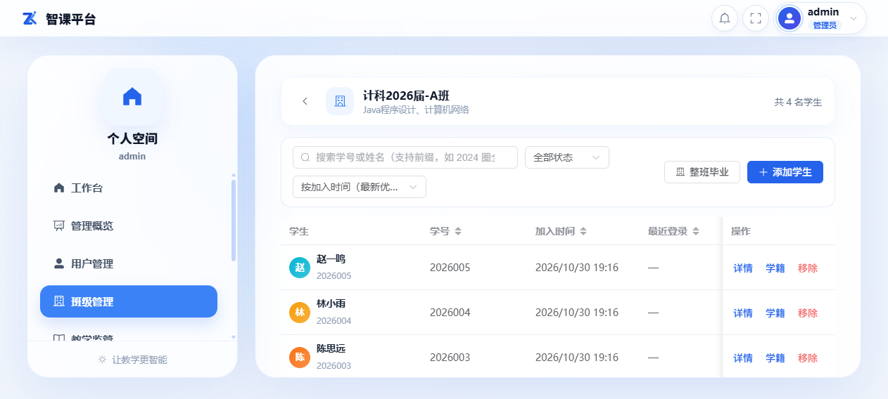

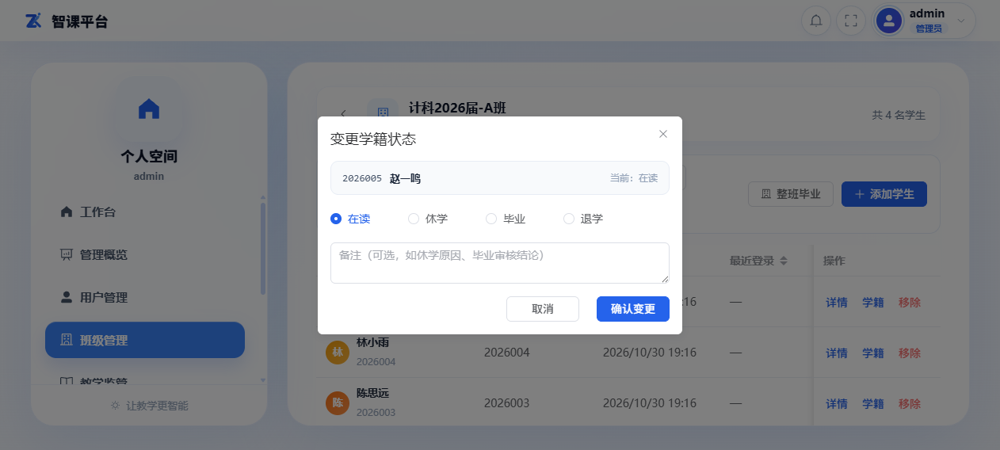

> **学籍门控**：学籍非「在校」的学生无法提交作业、暂存附件、开始新考试、提交实验、向 AI 提问，页面会给出与后端一致的中文原因；「已毕业」学生仍可回看学习记录（学习类操作只拦「休学」）。交卷不受门控限制。

### 4.3.3 整班毕业

1. 进入班级名单页，点击「整班毕业」；
2. 系统先**预览**本批将毕业的学生名单，以及在途答卷 / 未完成作业（可选择强制毕业时一并清理）；
3. 确认执行后，班级状态转为「已毕业」，本批学生学籍置为「已毕业」；
4. 误操作可**撤销**——只回滚本批标记的学生，不影响此前手工调整过的学籍。

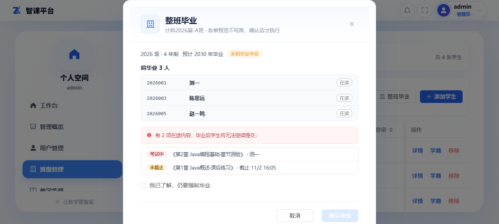

> 毕业班的学习进度类统计分母会归零（不再显示为全员未完成），避免误判教学质量。

### 4.3.4 班级挂课

在班级卡片上点「编辑班级」，弹窗中的「关联课程」即可选择/追加该班要开设的课程（多选，已选课程显示为标签）；同一弹窗还可调整届别、学制、开课与结课时间、班级状态。保存为**追加语义**，不会覆盖或移除同班其他教师挂的课。

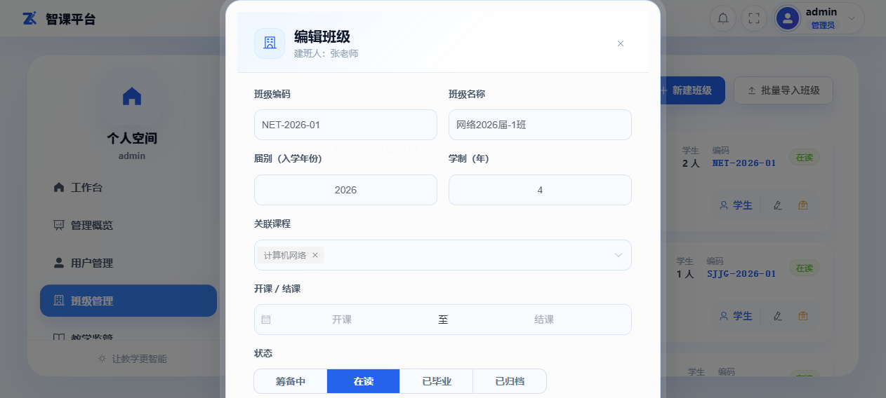

## 4.4 教学监管

**入口**：左侧菜单「教学监管」。

从平台视角巡查各课程、班级的教学活动运行情况（课程建设进度、作业考试开展、学习活跃等），支持下钻到具体班级/课程查看明细。

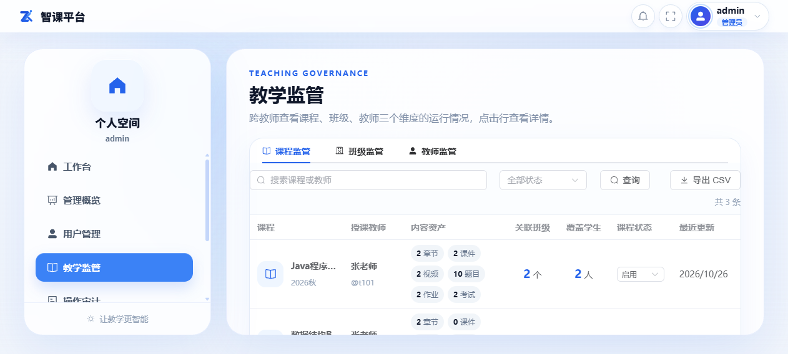

## 4.5 操作审计

**入口**：左侧菜单「操作审计」。

记录平台关键操作与配置变更（含大模型配置的字段级旧值→新值），支持按操作人、类型、时间筛选与查看详情。API Key 等敏感信息只记录「已配置/未配置」，不落密钥内容。

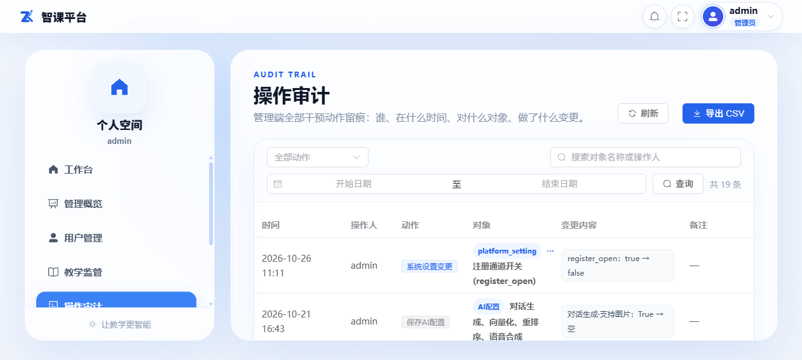

## 4.6 大模型配置

**入口**：左侧菜单「大模型配置」。

### 4.6.1 能力配置（Tab 1）

系统按**四项能力**分别配置服务商与模型，可混搭：

| 能力 | 用途 | 可选服务商 |
|---|---|---|
| 对话（chat） | 讲稿生成、AI 问答、生题、学情报告等 | DeepSeek / 通义千问 / OpenAI 兼容 / 模拟模式 |
| 向量化（embedding） | 知识库检索 | 通义千问 / OpenAI 兼容 |
| 重排（rerank） | 检索结果精排 | 通义千问 / OpenAI 兼容 |
| 语音合成（tts） | 课件配音 | 通义千问 / OpenAI 兼容 |

「当前生效配置」表格展示每项能力的：服务商/模型（含超时、发音人）、API Key（掩码）、实际运行时、来源（管理端配置/环境变量）、是否支持图片输入（影响问答页图片入口）。

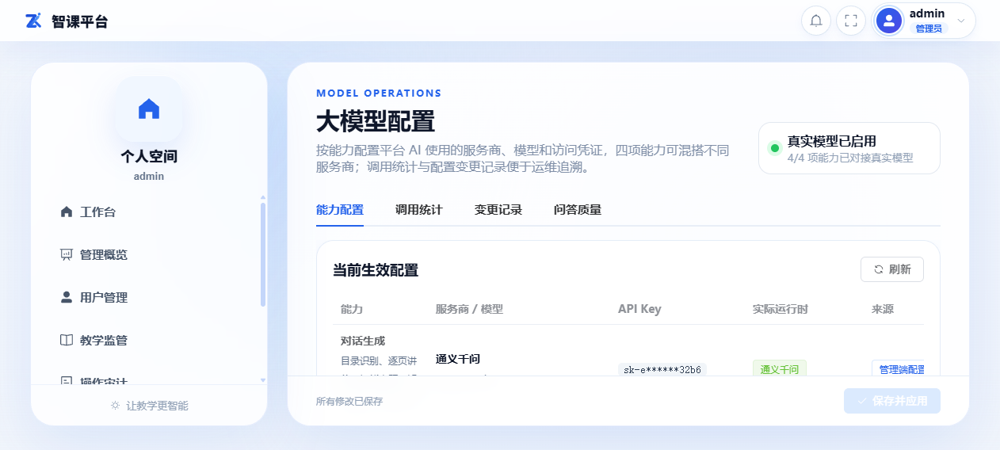

**修改配置**：

1. 在下方编辑区选择能力，填写服务商、模型名、API Key（加密保存；留空表示不修改现有 Key）；
2. 建议先点击「测试连接」验证可用性；
3. 点击「保存并应用」生效，同时记录一条配置变更审计。

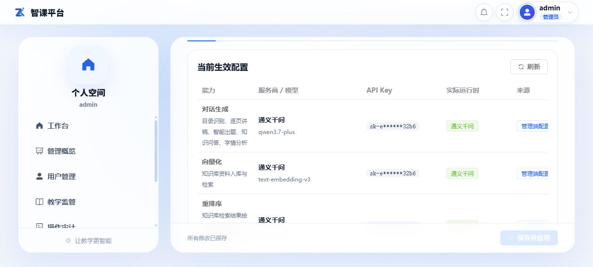

**配置优先级**：管理端配置 > 环境变量 > 模拟模式（Mock）。未做任何配置时系统回退到模拟模式，仅用于演示，不产生真实 AI 效果。

> 注意：更换向量模型后，需要对存量知识库执行「重建向量」才能生效（知识库页操作）；对话模型是否支持图片输入由系统按配置自动判定，支持时学生/教师问答页才显示图片上传入口。

### 4.6.2 AI 日配额

能力配置下方的「AI 日配额」卡片用于控制每日调用上限：支持设置**全局默认**与**指定用户单独覆盖**，可查询、可修改后「保存配额」。超出配额时用户侧返回中文提示并带专用错误码，问答/生成入口直接展示原因，避免无谓重试。

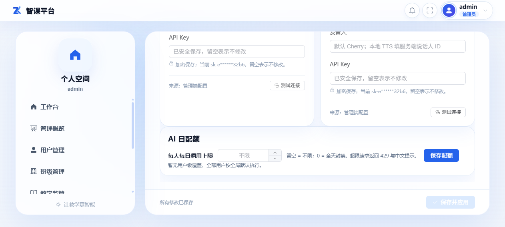

> 配额按自然日重置；调小配额不影响当天已发起的任务，只拦截新请求。

### 4.6.3 调用统计与变更记录（Tab 2/3）

查看各能力的调用量、耗时与成功率统计，以及配置变更历史（谁、何时、改了哪些字段）。调用分布、上下文降级与引用来源的条形长度按「占总量比例」绘制，与右侧百分比同口径。

> 若真实模型不可用、系统降级为内置模拟数据，学生/教师问答回答处会显示「模拟数据」角标，本页顶部同时给出 24 小时内的回退告警条——看到该提示请检查服务商密钥与网络，不要把模拟结果当作真实模型输出。

### 4.6.4 问答质量看板（Tab 4）

平台级问答质量监控：全站提问量、空答率、踩评率趋势，按课程下钻；另含 AI 调用健康度（失败率、费用口径）与平台级告警。课程级明细由教师在「问答质量」页查看。

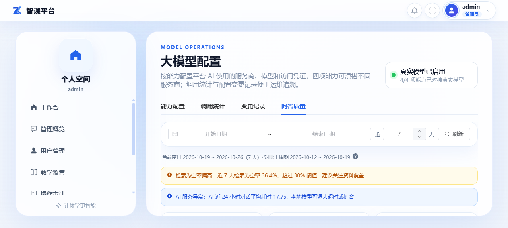
