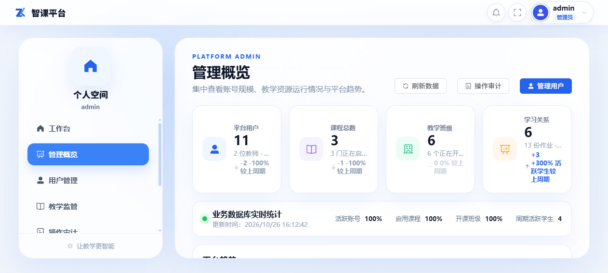
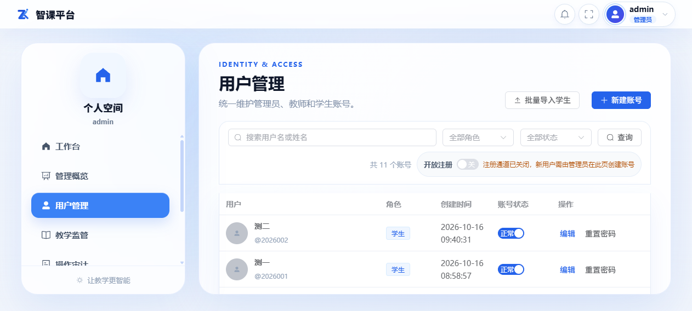
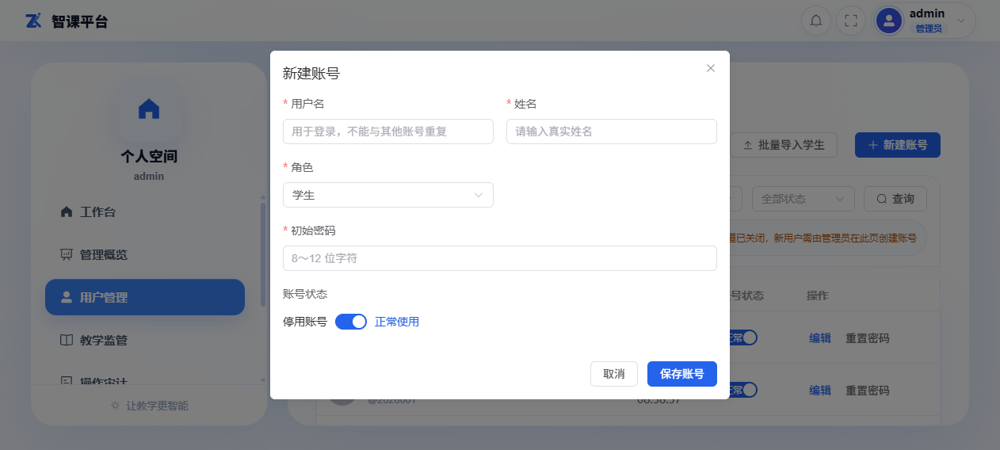
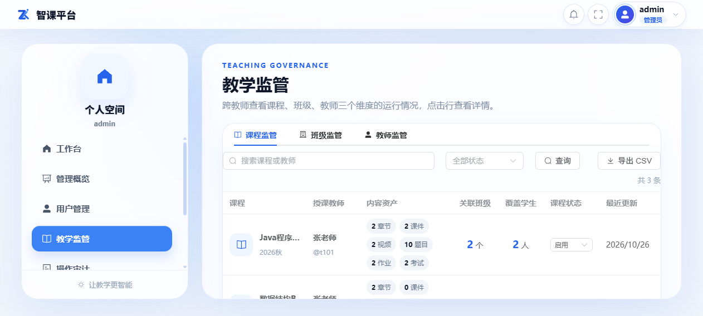
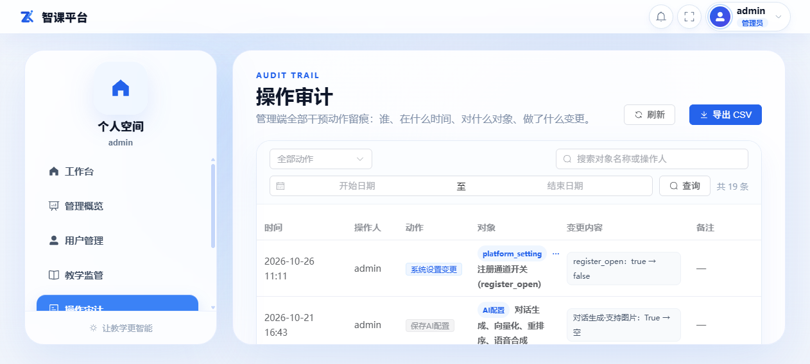
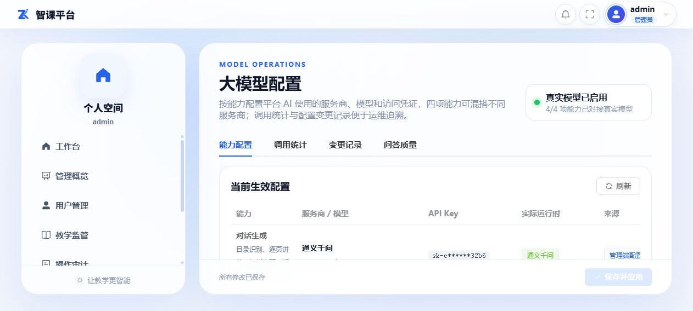
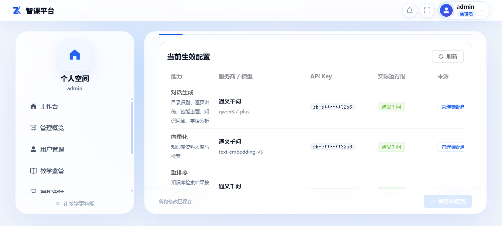
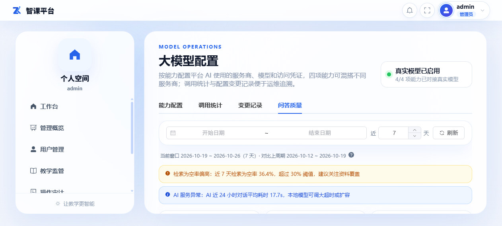

# 第四篇 管理员使用指南

> 管理员负责平台账号、运行监管与 AI 能力配置。管理员账号拥有全站通行权，请妥善保管密码，日常教学请勿使用管理员账号操作。

## 4.1 管理概览

**入口**：左侧菜单「管理概览」。

集中查看平台规模与运行趋势：平台用户（教师/学生数及环比）、课程总数、教学班级、学习关系与活跃度，以及业务数据库实时统计。

## 4.2 用户管理

**入口**：左侧菜单「用户管理」。

### 4.2.1 新建账号

1. 点击工具栏「新建账号」；
2. 填写用户名（教师工号/学生学号）、姓名、角色；
3. 保存后系统自动生成初始密码，规则为 `Zk` + 用户名后 6 位（新建与重置密码时默认填入，可修改），请提醒用户首次登录修改。

### 4.2.2 批量导入学生

1. 点击「下载导入模板」，按模板填写学生名单；
2. 点击「批量导入学生」上传文件，系统逐行校验并反馈结果；
3. 姓名、用户名为必填；学生后续凭初始密码登录。

### 4.2.3 编辑、重置密码与停用

- 行内「编辑」可修改姓名、角色等；「删除」移除账号（有教学数据的账号受保护，需先清理关联数据）；
- 用户忘记密码时使用「重置密码」，重置后按初始密码规则告知；
- 表格支持按角色/关键字查询与导出。

### 4.2.4 开放注册开关

工具栏「开放注册」开关（见 4.2.1 用户管理截图的工具栏区域）控制登录页是否显示注册入口。**默认关闭**（新部署系统即为关闭状态）；关闭时登录页注册入口隐藏，注册接口同时拒绝请求。

## 4.3 教学监管

**入口**：左侧菜单「教学监管」。

从平台视角巡查各课程、班级的教学活动运行情况（课程建设进度、作业考试开展、学习活跃等），支持下钻到具体班级/课程查看明细。

## 4.4 操作审计

**入口**：左侧菜单「操作审计」。

记录平台关键操作与配置变更（含大模型配置的字段级旧值→新值），支持按操作人、类型、时间筛选与查看详情。API Key 等敏感信息只记录「已配置/未配置」，不落密钥内容。

## 4.5 大模型配置

**入口**：左侧菜单「大模型配置」。

### 4.5.1 能力配置（Tab 1）

系统按**四项能力**分别配置服务商与模型，可混搭：

| 能力 | 用途 | 可选服务商 |
|---|---|---|
| 对话（chat） | 讲稿生成、AI 问答、生题、学情报告等 | DeepSeek / 通义千问 / OpenAI 兼容 / 模拟模式 |
| 向量化（embedding） | 知识库检索 | 通义千问 / OpenAI 兼容 |
| 重排（rerank） | 检索结果精排 | 通义千问 / OpenAI 兼容 |
| 语音合成（tts） | 课件配音 | 通义千问 / OpenAI 兼容 |

「当前生效配置」表格展示每项能力的：服务商/模型（含超时、发音人）、API Key（掩码）、实际运行时、来源（管理端配置/环境变量）、是否支持图片输入（影响问答页图片入口）。

**修改配置**：

1. 在下方编辑区选择能力，填写服务商、模型名、API Key（加密保存；留空表示不修改现有 Key）；
2. 建议先点击「测试连接」验证可用性；
3. 点击「保存并应用」生效，同时记录一条配置变更审计。

**配置优先级**：管理端配置 > 环境变量 > 模拟模式（Mock）。未做任何配置时系统回退到模拟模式，仅用于演示，不产生真实 AI 效果。

> 注意：更换向量模型后，需要对存量知识库执行「重建向量」才能生效（知识库页操作）；对话模型是否支持图片输入由系统按配置自动判定，支持时学生/教师问答页才显示图片上传入口。

### 4.5.2 调用统计与变更记录（Tab 2/3）

查看各能力的调用量、耗时与成功率统计，以及配置变更历史（谁、何时、改了哪些字段）。

### 4.5.3 问答质量看板（Tab 4）

平台级问答质量监控：全站提问量、空答率、踩评率趋势，按课程下钻；另含 AI 调用健康度（失败率、费用口径）与平台级告警。课程级明细由教师在「问答质量」页查看。

